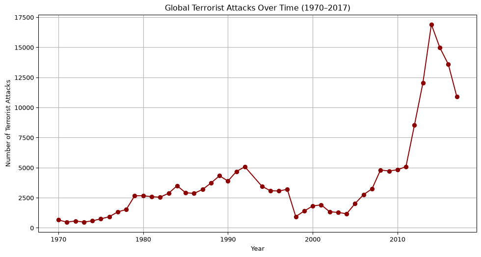
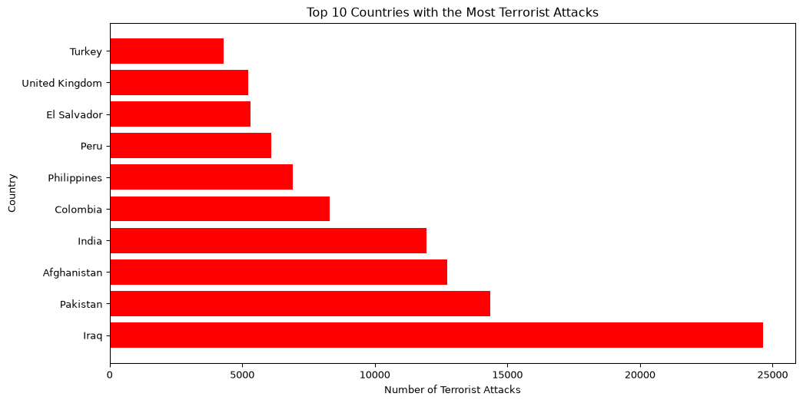
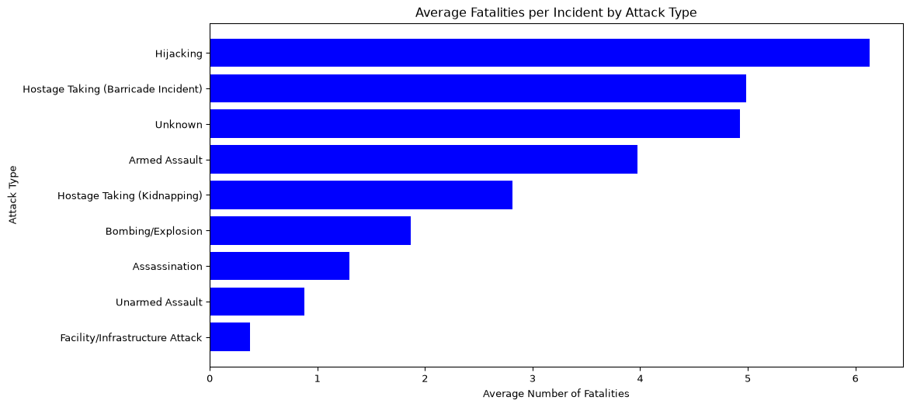
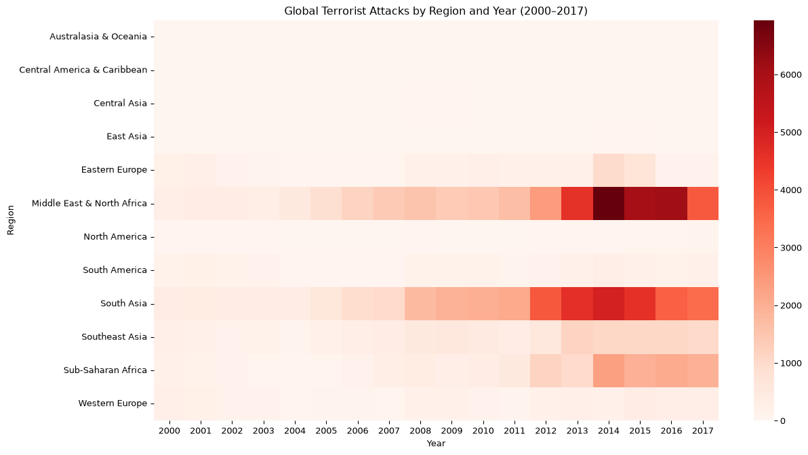
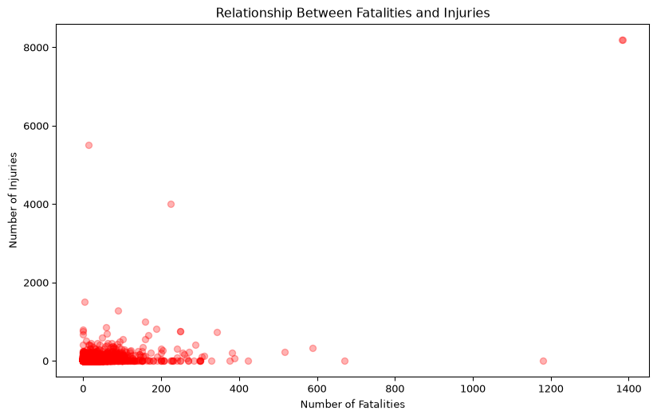

# Data Wrangling Final: Global Terrorism Analysis


## Introduction

Terrorism is a major global security concern that affects countries,
governments, and civilian populations. Understanding historical patterns
in terrorist attacks can help identify geographic trends, common attack
methods, and the severity of incidents across different regions.

For this project, I will analyze the Global Terrorism Database, which
contains information about terrorist incidents worldwide from 1970 to
2017. I will examine how the frequency of attacks has changed over time,
which countries have experienced the most incidents, which attack types
have resulted in the most fatalities, and how terrorist activity varies
across geographic regions. I will also investigate the relationship
between fatalities and injuries.

The goal of this analysis is to better understand historical patterns in
terrorism and identify trends that may be useful for national security
research and policy analysis.

## Loading in Packages

``` python
import pandas as pd
import numpy as np
import matplotlib.pyplot as plt
import seaborn as sns
```

## Loading in Data

``` python
data = pd.read_csv(
    "C:/Users/SheaD/Wrangling/globalterrorism_data.csv",
    encoding="latin1",
    low_memory=False
)

data.head()
data.tail()
data.shape
data.dtypes
data.describe(include='all')
data.isnull().sum()
```

    eventid            0
    iyear              0
    imonth             0
    iday               0
    approxdate    172452
                   ...  
    INT_LOG            0
    INT_IDEO           0
    INT_MISC           0
    INT_ANY            0
    related       156653
    Length: 135, dtype: int64

The dataset contains 181,691 observations and 135 variables. Each
observation represents a recorded terrorist incident, while the
variables describe characteristics such as the location, year, attack
type, casualties, and group responsible.

## Cleaning the Data

``` python
columns = [
    'iyear',
    'country_txt',
    'region_txt',
    'attacktype1_txt',
    'targtype1_txt',
    'weaptype1_txt',
    'nkill',
    'nwound',
    'gname',
    'success'
]

data = data[columns].copy()

data = data.rename(columns={
    'iyear': 'year',
    'country_txt': 'country',
    'region_txt': 'region',
    'attacktype1_txt': 'attack_type',
    'targtype1_txt': 'target_type',
    'weaptype1_txt': 'weapon_type',
    'nkill': 'fatalities',
    'nwound': 'injuries',
    'gname': 'group_name'
})

data['fatalities'] = pd.to_numeric(
    data['fatalities'], errors='coerce'
)

data['injuries'] = pd.to_numeric(
    data['injuries'], errors='coerce'
)

data.isnull().sum()

data.head()
```

<div>
<style scoped>
    .dataframe tbody tr th:only-of-type {
        vertical-align: middle;
    }
&#10;    .dataframe tbody tr th {
        vertical-align: top;
    }
&#10;    .dataframe thead th {
        text-align: right;
    }
</style>

|  | year | country | region | attack_type | target_type | weapon_type | fatalities | injuries | group_name | success |
|----|----|----|----|----|----|----|----|----|----|----|
| 0 | 1970 | Dominican Republic | Central America & Caribbean | Assassination | Private Citizens & Property | Unknown | 1.0 | 0.0 | MANO-D | 1 |
| 1 | 1970 | Mexico | North America | Hostage Taking (Kidnapping) | Government (Diplomatic) | Unknown | 0.0 | 0.0 | 23rd of September Communist League | 1 |
| 2 | 1970 | Philippines | Southeast Asia | Assassination | Journalists & Media | Unknown | 1.0 | 0.0 | Unknown | 1 |
| 3 | 1970 | Greece | Western Europe | Bombing/Explosion | Government (Diplomatic) | Explosives | NaN | NaN | Unknown | 1 |
| 4 | 1970 | Japan | East Asia | Facility/Infrastructure Attack | Government (Diplomatic) | Incendiary | NaN | NaN | Unknown | 1 |

</div>

I wrote this code to prepare the dataset for answering my five research
questions. First, I selected ten variables that were most relevant to my
analysis and renamed several columns to make them easier to understand
and work with. I also converted the fatalities and injuries columns to
numeric values to ensure they could be used in calculations and
visualizations.

After examining missing values, I found that some incidents did not have
recorded fatality or injury counts. Rather than removing all of these
observations, I decided to handle missing values separately for
questions involving casualties. This allows me to preserve as much
information as possible when analyzing the frequency and geographic
distribution of terrorist attacks.

## Question 1: How has the number of terrorist attacks changed over time?

``` python
yearly_attacks = data.groupby('year').size()

plt.figure(figsize=(12, 6))

plt.plot(yearly_attacks.index, yearly_attacks.values,
         color='darkred', marker='o')

plt.title('Global Terrorist Attacks Over Time (1970–2017)')
plt.xlabel('Year')
plt.ylabel('Number of Terrorist Attacks')

plt.grid(True)

plt.show()

print(yearly_attacks)
```



    year
    1970      651
    1971      471
    1972      568
    1973      473
    1974      581
    1975      740
    1976      923
    1977     1319
    1978     1526
    1979     2662
    1980     2662
    1981     2586
    1982     2544
    1983     2870
    1984     3495
    1985     2915
    1986     2860
    1987     3183
    1988     3721
    1989     4324
    1990     3887
    1991     4683
    1992     5071
    1994     3456
    1995     3081
    1996     3058
    1997     3197
    1998      934
    1999     1395
    2000     1814
    2001     1906
    2002     1333
    2003     1278
    2004     1166
    2005     2017
    2006     2758
    2007     3242
    2008     4805
    2009     4721
    2010     4826
    2011     5076
    2012     8522
    2013    12036
    2014    16903
    2015    14965
    2016    13587
    2017    10900
    dtype: int64

This code was used to examine how the number of recorded terrorist
attacks changed between 1970 and 2017. I grouped the dataset by year and
counted the number of incidents occurring annually. I then created a
line chart to visualize historical trends and highlighted the year with
the highest number of attacks.

The results show that recorded terrorist attacks increased significantly
over the period, particularly after 2011. The highest number of
incidents occurred in 2014, with 16,903 recorded attacks. Following this
peak, the number of attacks declined to 10,900 in 2017. These findings
suggest that terrorist activity was not consistent over time, with
certain periods experiencing substantial increases in recorded
incidents. Changes in reporting and database coverage may also affect
the observed trends.

## Question 2: Which countries experienced the highest number of terrorist attacks?

``` python
country_attacks = data.groupby('country').size()

top_countries = country_attacks.sort_values(ascending=False).head(10)

plt.figure(figsize=(12, 6))

plt.barh(top_countries.index, top_countries.values, color='red')

plt.title('Top 10 Countries with the Most Terrorist Attacks')
plt.xlabel('Number of Terrorist Attacks')
plt.ylabel('Country')

plt.show()

print(top_countries)
```



    country
    Iraq              24636
    Pakistan          14368
    Afghanistan       12731
    India             11960
    Colombia           8306
    Philippines        6908
    Peru               6096
    El Salvador        5320
    United Kingdom     5235
    Turkey             4292
    dtype: int64

This code was used to identify the ten countries that experienced the
highest number of recorded terrorist attacks. I grouped the dataset by
country and counted the total number of incidents associated with each
country. I then sorted the results and created a horizontal bar chart to
compare the countries.

The results show that Iraq experienced the highest number of recorded
terrorist attacks, with 24,636 incidents, followed by Pakistan with
14,368 and Afghanistan with 12,731. India and Colombia also ranked among
the countries with the most incidents. These findings indicate that
terrorist activity has been concentrated in certain countries,
particularly those that have experienced prolonged political instability
or armed conflict. However, these are cumulative counts over the study
period rather than population-adjusted rates.

## Question 3: Which types of terrorist attacks resulted in the highest average number of fatalities?

``` python
fatality_data = data.dropna(subset=['fatalities'])

attack_fatalities = fatality_data.groupby('attack_type')['fatalities'].mean()

attack_fatalities = attack_fatalities.sort_values(ascending=False)

plt.figure(figsize=(12, 6))

plt.barh(attack_fatalities.index, attack_fatalities.values, color='blue')

plt.title('Average Fatalities per Incident by Attack Type')
plt.xlabel('Average Number of Fatalities')
plt.ylabel('Attack Type')

plt.gca().invert_yaxis()

plt.show()

print(attack_fatalities)
```



    attack_type
    Hijacking                              6.135314
    Hostage Taking (Barricade Incident)    4.986637
    Unknown                                4.930866
    Armed Assault                          3.972369
    Hostage Taking (Kidnapping)            2.814286
    Bombing/Explosion                      1.865717
    Assassination                          1.295690
    Unarmed Assault                        0.879121
    Facility/Infrastructure Attack         0.372088
    Name: fatalities, dtype: float64

This code was used to compare the average number of fatalities
associated with different types of terrorist attacks. I removed
observations with missing fatality counts, grouped the remaining data by
attack type, and calculated the average number of fatalities per
incident. I then created a horizontal bar chart to compare the severity
of different attack methods.

The results show that hijackings had the highest average number of
fatalities, with approximately 6.14 deaths per incident. Hostage-taking
involving barricade situations had the second-highest average, with
approximately 4.99 fatalities. Armed assaults averaged approximately
3.97 fatalities per incident, while facility and infrastructure attacks
had the lowest average at approximately 0.37. These findings suggest
that certain types of attacks tend to result in more fatalities per
incident than others. However, averages can be influenced by unusually
severe incidents, and the analysis excludes observations with unknown
fatality counts.

## Question 4: How have terrorist attack patterns differed across geographic regions over time?

For this question, I chose a heatmap because it allows me to compare
terrorist activity across multiple regions and years in one
visualization. Darker colors will represent years and regions with
higher numbers of recorded attacks.

``` python
recent_data = data[data['year'] >= 2000]

region_year = recent_data.groupby(['region', 'year']).size()

heatmap_data = region_year.unstack(fill_value=0)

plt.figure(figsize=(14, 8))

sns.heatmap(heatmap_data, cmap='Reds')

plt.title('Global Terrorist Attacks by Region and Year (2000–2017)')
plt.xlabel('Year')
plt.ylabel('Region')

plt.show()

print(heatmap_data)
```



    year                         2000  2001  2002  2003  2004  2005  2006  2007  \
    region                                                                        
    Australasia & Oceania           6     4     2     4     0     0     2     1   
    Central America & Caribbean    14     8     3     8     5     3     5     4   
    Central Asia                   21    18     6     7     8    11     6     4   
    East Asia                      19    19     4     6     4     2     1     0   
    Eastern Europe                234   252   112   100    46    76    70    62   
    Middle East & North Africa    272   362   326   310   492   882  1187  1385   
    North America                  41    48    33    34    12    22    15    18   
    South America                 150   229   162   117    42    49    50    47   
    South Asia                    357   385   334   353   369   604   938   982   
    Southeast Asia                256   185   110   145    95   204   272   365   
    Sub-Saharan Africa            191   162   121    73    34    60   114   302   
    Western Europe                253   234   120   121    59   104    98    72   

    year                         2008  2009  2010  2011  2012  2013  2014  2015  \
    region                                                                        
    Australasia & Oceania           8     1     1     0     0     1     9    14   
    Central America & Caribbean     0     9     1     1     1    14     5     1   
    Central Asia                   36    31     9     9    12     7     9    10   
    East Asia                      25     8     1     4     4    15    43    28   
    Eastern Europe                209   165   261   198   173   165   962   684   
    Middle East & North Africa   1536  1361  1463  1663  2409  4560  6939  6036   
    North America                  31    16    24    12    39    32    37    62   
    South America                 144   159   148   106   133   182   283   176   
    South Asia                   1759  1945  1981  2138  3803  4612  4998  4585   
    Southeast Asia                514   561   473   356   587  1188  1082  1072   
    Sub-Saharan Africa            380   283   331   494  1168   999  2321  1964   
    Western Europe                163   182   133    95   193   261   215   333   

    year                         2016  2017  
    region                                   
    Australasia & Oceania          10    12  
    Central America & Caribbean     3     4  
    Central Asia                   17     7  
    East Asia                       8     7  
    Eastern Europe                134   110  
    Middle East & North Africa   6115  3780  
    North America                  75    97  
    South America                 159   172  
    South Asia                   3639  3430  
    Southeast Asia               1077  1020  
    Sub-Saharan Africa           2077  1970  
    Western Europe                273   291  

This code was used to examine how the number of terrorist attacks
differed across geographic regions between 2000 and 2017. I filtered the
dataset to focus on more recent historical incidents, grouped the data
by region and year, and counted the number of attacks. I then used
pivot_table() to reorganize the data into a format suitable for a
heatmap, where each row represents a geographic region and each column
represents a year.

The heatmap uses lighter colors to represent fewer attacks and darker
red colors to represent higher numbers of attacks. The results show that
the Middle East and North Africa and South Asia experienced particularly
high concentrations of terrorist activity, especially after 2011. The
Middle East and North Africa recorded its highest number of attacks in
2014, with 6,939 incidents. These findings demonstrate that terrorist
activity has varied considerably across regions and time, with certain
areas experiencing significant increases in recorded incidents.

## Question 5: Is there a relationship between the number of fatalities and injuries in terrorist attacks?

For this question, I chose a scatter plot with a regression line to
determine whether incidents with more fatalities also tend to result in
more injuries.

``` python
casualty_data = data.dropna(subset=['fatalities', 'injuries'])

correlation = casualty_data['fatalities'].corr(casualty_data['injuries'])

plt.figure(figsize=(10, 6))

plt.scatter(casualty_data['fatalities'],
            casualty_data['injuries'],
            color='red', alpha=0.3)

plt.title('Relationship Between Fatalities and Injuries')
plt.xlabel('Number of Fatalities')
plt.ylabel('Number of Injuries')

plt.show()

print('Correlation:', correlation)
```



    Correlation: 0.5343752155742121

This code was used to examine whether terrorist incidents resulting in
more fatalities also tend to result in more injuries. I removed
observations with missing fatality or injury counts and created a
scatter plot comparing the two variables. I also added a regression line
and calculated the Pearson correlation coefficient to measure the
strength and direction of their relationship.

The correlation coefficient was approximately 0.534, indicating a
moderate positive relationship between fatalities and injuries. This
suggests that terrorist incidents resulting in higher numbers of
fatalities also tend to result in higher numbers of injuries. However,
the relationship is not perfect, meaning that some incidents result in
many injuries but relatively few fatalities, while others result in more
fatalities than injuries. These findings demonstrate that the severity
of terrorist attacks can vary considerably across incidents.

## Conclusion

This project analyzed global terrorism trends between 1970 and 2017,
focusing on attack frequency, geographic distribution, attack methods,
and severity. The results showed that terrorist attacks increased
significantly over time, peaking at **16,903 incidents in 2014**. Iraq
recorded the most attacks, followed by Pakistan and Afghanistan, while
hijackings had the highest average fatalities per incident. The Middle
East and North Africa and South Asia experienced the greatest
concentrations of terrorist activity, particularly during the 2010s.
Additionally, fatalities and injuries showed a moderate positive
correlation.

Overall, these findings highlight how terrorist activity varies across
time, location, and attack type. This analysis provides valuable
insights into historical security threats and patterns that could
support national security research. However, because the dataset ends in
2017, future research should incorporate more recent data to examine
current terrorism trends.
